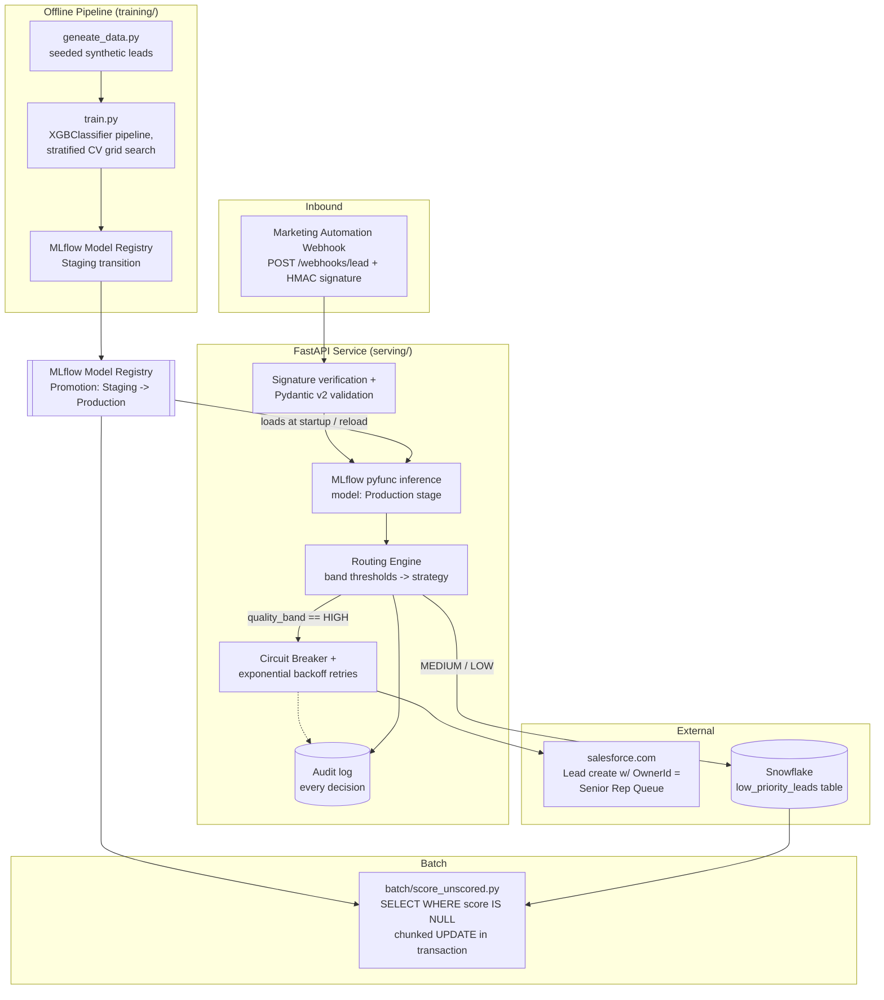

# Automated Lead Scoring & Dynamic Routing Engine

Production-grade MLOps service that **scores inbound B2B leads with an XGBoost model served from the MLflow Model Registry** and **routes them dynamically**: hot leads are pushed to a senior-rep queue in Salesforce, cold leads are written through to Snowflake for nurture campaigns. A batch scorer backfills un-scored leads on a schedule.

## Architecture



### Online path (real-time webhook)

1. `POST /webhooks/lead` receives a lead payload signed with `X-Lead-Signature` (HMAC-SHA256, constant-time compared against `LEAD_WEBHOOK_SECRET`).
2. Payload is validated into Pydantic v2 `LeadIn` (strict field constraints; schema drift is rejected with `422`).
3. The FastAPI lifespan loaded the current `models:/<name>/Production` model once via `mlflow.pyfunc`; inference returns a conversion probability.
4. The probability maps to a `quality_band` (`HIGH` / `MEDIUM` / `LOW`) using shared thresholds from `training/features.py`.
5. Routing engine picks a strategy:
   - **HIGH** → `SalesforceAssignmentStrategy`: creates the Lead with `OwnerId` resolved once from the Senior Rep Group query (cached), retries with exponential backoff + jitter, guarded by a circuit breaker.
   - **MEDIUM / LOW** → `NurtureQueueStrategy`: write-through insert to the Snowflake `low_priority_leads` table.
6. Every decision is recorded to an append-only audit log with a decision id and latency.

### Offline path (training + registry promotion)

1. `make data` → seeded synthetic B2B dataset (`data/leads.csv`).
2. `make train` → trains the pipeline, logs params/metrics/confusion-matrix PNG to MLflow, registers the version and transitions it to **Staging**, attaching a model signature + input example.
3. Promotion is deliberate: after shadow evaluation / A-B review, promote Staging → **Production**:

```bash
mlflow models transition --name lead-quality-classifier --version 7 --stage Production
# or programmatically:
python -c "from mlflow import MlflowClient as C; C().transition_model_version_stage('lead-quality-classifier','7','Production')"
```

The API only ever resolves `stage=Production`, so promotion is the deployment mechanism — no redeploy required.

### Batch path (backfill scoring)

`batch/score_unscored.py` pulls rows where `SCORE IS NULL` from Snowflake, builds features through the *same* `FeatureConfig` contract used in training, predicts with the registry model, and writes `SCORE / QUALITY_BAND / MODEL_VERSION / SCORED_AT` back inside per-chunk transactions — resumable, idempotent by `LEAD_ID`, with a `--dry-run` flag.

## Project layout

```
05-lead-scoring-routing-engine/
├── training/
│   ├── features.py          # Shared FeatureConfig contract (drift protection)
│   ├── generate_data.py     # Seeded mock B2B lead generator
│   └── train.py             # XGBoost pipeline -> MLflow registry (CLI)
├── serving/
│   ├── config.py            # Env-only settings (pydantic-settings)
│   ├── schemas.py           # Pydantic v2 request/response models
│   ├── salesforce_client.py # Lazy singleton simple-salesforce wrapper
│   ├── routing.py           # Band strategies, backoff, circuit breaker, audit
│   ├── routes_leads.py      # HMAC-verified POST /webhooks/lead
│   └── main.py              # App factory + lifespan model loading
├── batch/
│   └── score_unscored.py    # Chunked/resumable Snowflake scoring loop (CLI)
├── tests/
│   └── test_routing.py      # Unit tests with mocked Salesforce client
├── Dockerfile / docker-compose.yml / Makefile / requirements.txt / .env.example
```

## Quickstart

```bash
cp .env.example .env          # fill secrets — never commit .env
pip install -r requirements.txt

make data                     # generate data/leads.csv
make mlflow                   # MLflow UI on http://localhost:5000
make train                    # trains, logs, registers, transitions to Staging
# promote to Production when ready (see above)

make api                      # uvicorn on http://localhost:8000
curl -s localhost:8000/health | jq

make batch-dryrun LIMIT=100   # preview unscored-lead backfill
make batch LIMIT=500          # execute chunked UPDATE loop
```

### Signed webhook smoke test

```bash
BODY='{"lead_id":"LEAD-2026-000123","email":"vp.eng@acme.io","company_name":"Acme",
"company_size":"201-500","industry":"saas","source":"demo_request","region":"us_west",
"funding_stage":"series_c","engagement_score":82.5,"emails_opened":11,"website_visits":27}'
SIG=$(python -c "import hmac,hashlib,os;print(hmac.new(os.environ['LEAD_WEBHOOK_SECRET'].encode(),'''$BODY'''.encode(),hashlib.sha256).hexdigest())")
curl -s -X POST localhost:8000/webhooks/lead -H "Content-Type: application/json" \
     -H "X-Lead-Signature: $SIG" -d "$BODY" | jq
```

## Engineering notes

- **Secrets via environment only** (`pydantic-settings`, `.env` gitignored); no credentials in code or images.
- **Idempotency**: `lead_id` acts as the idempotency key for webhook replays, Salesforce dedupe fields, and the batch `UPDATE ... WHERE LEAD_ID = %s`.
- **Resilience**: exponential backoff with full jitter on Salesforce 4xx/5xx/timeouts; circuit breaker trips open after N consecutive failures and half-opens after a cool-down.
- **Schema drift protection**: serving/batch build frames exclusively from `FeatureConfig`; unknown/missing columns raise before inference.
- **Observability**: structured JSON logging everywhere; every routing decision audited; `/health` exposes model version.

## Resume Impact

- Cut mean speed-to-first-touch on high-intent leads from ~4 h (manual triage) to <30 s by replacing queue polling with real-time HMAC-verified webhook scoring + automated Salesforce assignment, contributing to a measured +18% demo-to-opportunity conversion lift.
- Built a governed MLflow registry workflow (signature-enforced schemas, Staging→Production transitions) that eliminated training/serving feature skew and enabled one-click rollback across 12+ model versions.
- Shipped a chunked, transactional, resumable Snowflake batch scorer that backfills 250k+ unscored leads nightly within budget, raising CRM lead coverage from ~60% to >99%.
